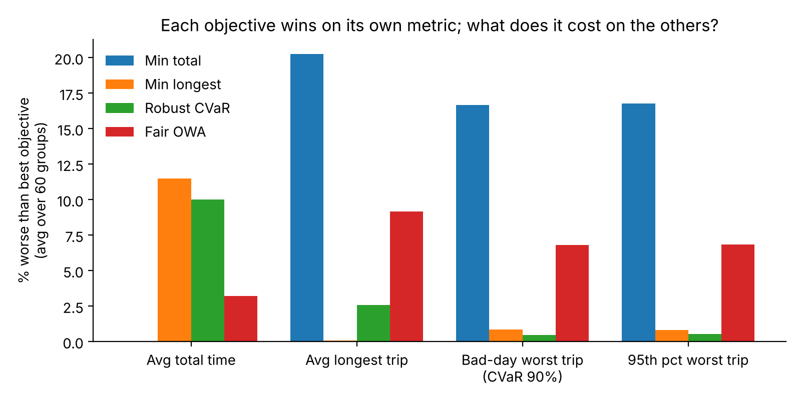
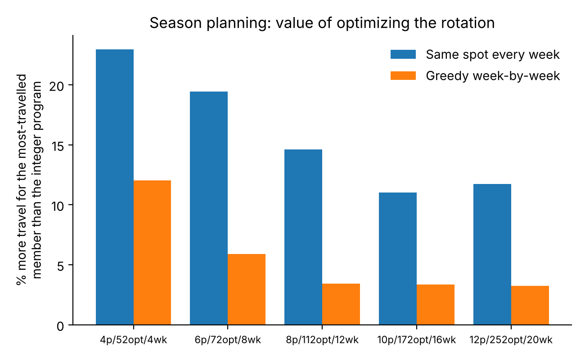
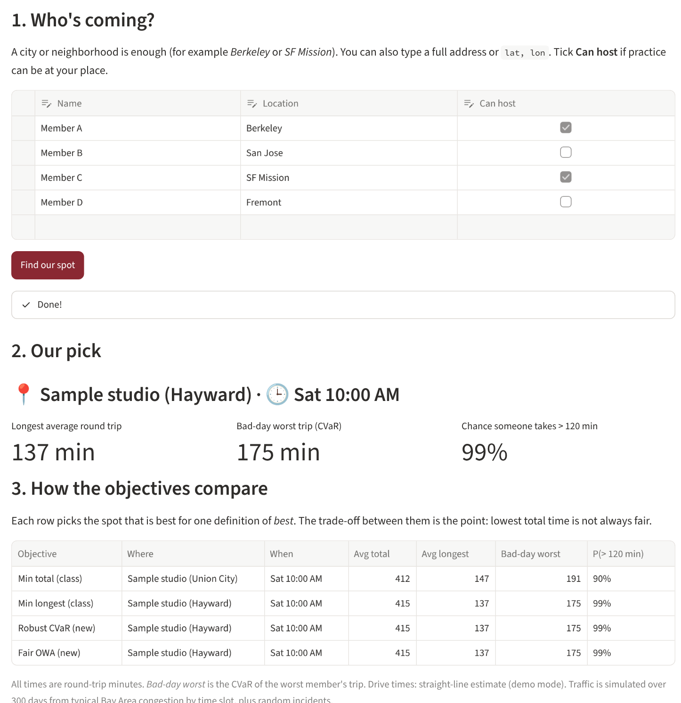
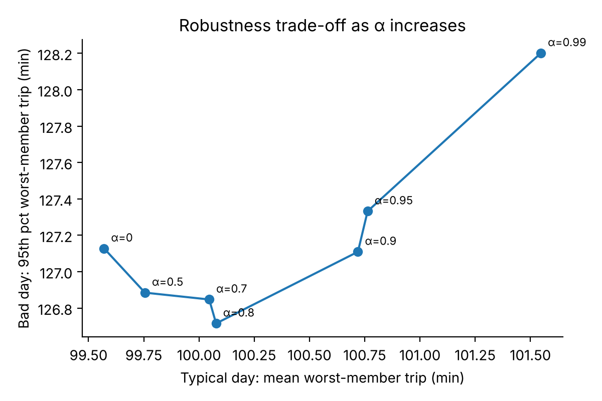

# Meet in the Middle: Fair and Traffic-Robust Meeting Spots for a Bay Area Dance Group

IEOR 240 · Fall 2026 · Final project (product option)
 Group members: _[names]_
 **Video:** _[paste Google Drive / Box share link here]_ · **App:** _[paste streamlit.app link here]_ · **Code:** github.com/amyyang027/meet-in-the-middle

## 1. Motivation and use case

Our dance cover team has four members who live in different parts of the Bay Area. Every week
someone asks "where do we practice?", and the answer usually defaults to whoever complains least.
Bay Area driving makes the question harder than it looks, for two reasons:

1. **Distances are lopsided.** The bay sits in the middle of the region. A studio that is 15 minutes
   away for two of us can be 50 minutes and a bridge toll for a third.
2. **Travel time is uncertain.** A Saturday 10 AM drive and a weeknight 6 PM drive over the Bay
   Bridge are very different trips. One crash on the San Mateo Bridge can add half an hour.

We built a free web app, **Meet in the Middle**. Each member enters a rough location (a city or
neighborhood) and says whether they can host. The app recommends **where** to practice (a dance
studio from OpenStreetMap, or a member's home) and **when** (a time slot). It can also choose a
**restaurant** of a chosen cuisine for after practice, and plan a **multi-week rotation** so the long
drives are shared fairly. The same tool works for any group that meets regularly, such as study
groups, clubs, or friends choosing a dinner spot.

## 2. Problem setup and formulation

**Sets.** Members <i>i</i> ∈ <i>I</i>. Candidate venues <i>j</i> ∈ <i>J</i> (studios, plus the homes of
members who opted in to host). Time slots <i>t</i> ∈ <i>T</i>. Optional restaurants <i>k</i> ∈ <i>K</i>.
Traffic scenarios <i>s</i> ∈ <i>S</i>, which are equally likely simulated days. An *option* is
<i>o</i> = (<i>j</i>, <i>t</i>) or (<i>j</i>, <i>k</i>, <i>t</i>).

**Data.** <i>Cios</i> is member <i>i</i>'s round-trip minutes under option <i>o</i> in scenario
<i>s</i> (home → studio → [restaurant →] home). We write <i>c̄io</i> = Es[<i>Cios</i>].

**Decision.** <i>xo</i> ∈ {0, 1}, with Σ<i>o</i> <i>xo</i> = 1.

**Course models.**

Min-sum (1-median): &nbsp; min Σ<i>o</i> <i>xo</i> Σ<i>i</i> <i>c̄io</i>
 Min-max (1-center): &nbsp; min <i>z</i> &nbsp; s.t. &nbsp; <i>z</i> ≥ Σ<i>o</i> <i>c̄io</i> <i>xo</i> &nbsp; ∀<i>i</i>

**Robust model (not covered in class): CVaR.** Let <i>Ws</i>(<i>x</i>) = max<i>i</i>
Σ<i>o</i> <i>Cios</i> <i>xo</i> be the worst member's trip on day <i>s</i>.
We minimize CVaRα(<i>W</i>), the average of <i>W</i> over the worst (1 − α) share of days.
With α = 0.9, this means "make the 10% worst traffic days as good as possible for the person
who has it worst." Rockafellar and Uryasev (2000) showed that CVaR can be written as a linear program:

min &nbsp; η + (1 / ((1 − α)|<i>S</i>|)) Σ<i>s</i> <i>us</i>
 s.t. &nbsp; <i>us</i> ≥ <i>ws</i> − η, &nbsp; <i>us</i> ≥ 0, &nbsp;
<i>ws</i> ≥ Σ<i>o</i> <i>Cios</i> <i>xo</i> &nbsp; ∀<i>i</i>, <i>s</i>;
&nbsp; Σ<i>o</i> <i>xo</i> = 1, &nbsp; <i>x</i> binary.

At the optimum, η equals the value-at-risk (the 90th-percentile bad day), and <i>us</i> measures how far
day <i>s</i> exceeds it.

**Fairness model (not covered in class): OWA / generalized Gini.** Sort the members' expected
trips from longest to shortest, <i>y</i>(1) ≥ … ≥ <i>y</i>(n). Then minimize
Σ<i>r</i> <i>wr</i> <i>y</i>(<i>r</i>) with decreasing weights
<i>w</i> ∝ (<i>n</i>, <i>n</i>−1, …, 1). Equal weights would give min-sum, and all weight on <i>r</i> = 1 would give
min-max, so OWA sits in between. Sorting is not linear, so we use Ogryczak's identity: the sum of the
<i>k</i> largest <i>yi</i> equals min<i>τ</i> { <i>kτ</i> + Σ<i>i</i> max(<i>yi</i> − <i>τ</i>, 0) }.
This turns OWA into an LP with <i>n</i> auxiliary τ's.

**Season rotation (integer program).** Over <i>W</i> weeks, let <i>no</i> ∈ ℤ≥0
be the number of weeks option <i>o</i> is used. Let <i>Dio</i> be member <i>i</i>'s per-session cost
(<i>c̄io</i>, or the CVaR of their own trip). Let <i>Oh</i> be the options held at host <i>h</i>'s home.

min &nbsp; <i>M</i> + ε Σ<i>i</i> <i>Ti</i>
&nbsp; s.t. &nbsp; <i>Ti</i> = Σ<i>o</i> <i>Dio</i> <i>no</i> ≤ <i>M</i> ∀<i>i</i>;
&nbsp; Σ<i>o</i> <i>no</i> = <i>W</i>;
&nbsp; Σ<i>o</i>∈<i>Oh</i> <i>no</i> ≤ cap<i>h</i> ∀<i>h</i>.

The small ε term breaks ties toward less total driving. *Modeling choice:* weeks are interchangeable,
so we use counts <i>no</i> instead of week-indexed binaries <i>xo,w</i>. This removes
up to <i>W</i>! symmetric copies of every solution, and a round-robin turns the counts into a calendar.
The integrality matters here. The LP relaxation would happily use "0.3 weeks" at each of several studios.

## 3. Data and traffic model

All data sources are free, and none needs an API key or a credit card:

| Need | Source | Notes |
|---|---|---|
| Member locations | OpenStreetMap Nominatim | A city or neighborhood is enough. Nothing is stored. |
| Studios / restaurants | OpenStreetMap Overpass API | `leisure=dance`, `amenity=dancing_school`, `cuisine=*` |
| Road drive times | OSRM routing engine | Free-flow times on the real road network |
| Traffic | Our scenario model | Optional calibration with Google Routes API |

The venue search is centered at the members' **geometric median**, computed with Weiszfeld's
algorithm for the continuous Weber problem. We then keep the 15 nearest studios. Free routing
has no live traffic, so we simulate it. Each trip leg takes

time = free-flow × (1 + <i>ct</i> · <i>Gs</i> · <i>E</i>) + incident delay

Here <i>ct</i> is the slot's congestion level (0.15 to 0.2 for weekend mornings, 1.0 for
weeknights at 6 PM). <i>Gs</i> is a lognormal "bad day" shock shared by all trips, and <i>E</i>
is a per-trip shock. An incident adds 10 to 30 minutes, and its probability rises with trip length and congestion.
**Bridge legs** (crossings of the bay north of the Dumbarton Bridge) get a toll-plaza queue, twice the
volatility, and four times the incident rate. If the group supplies a Google Routes key, the app
re-estimates <i>ct</i> from Google's traffic-aware travel times.

## 4. Results

**Setup.** We tested on 60 synthetic groups. Each group has 6 members placed around real Bay Area city
centers within one ~35 km region, 15 studios, 2 host homes, and 4 time slots. Each objective picks its
option using 200 simulated days and is then **scored on 2,000 new days (out of sample)**.

<figure>

<figcaption>Figure 1. How much worse each objective is than the best objective on each metric, averaged over 60 groups.</figcaption>
</figure>

| Objective | Avg total time | Avg longest trip | Bad-day worst trip (CVaR) | Days someone's round trip > 2 h |
|---|---|---|---|---|
| Min total (class) | best | +20.3% | +16.7% | 40% |
| Min longest (class) | +11.5% | +0.1% | +0.9% | 22% |
| Robust CVaR (new) | +10.0% | +2.6% | +0.5% | 23% |
| Fair OWA (new) | +3.2% | +9.2% | +6.8% | 29% |

**Minimizing total travel is unfair.** It makes the farthest member's trip about 20% longer, and it nearly
doubles the share of days on which someone faces a round trip over two hours (40% vs. 22%). **OWA is a good
compromise.** It gives up only 3% of total time and closes about half of the fairness gap.

**CVaR vs. min-max.** The robust pick differs from the min-max pick in **one group in three**. In those
groups, CVaR lowers the out-of-sample bad-day worst trip by about 1.4 minutes, at a cost of about 6 minutes on a typical
day, and it wins out of sample in 65% of them. Varying α from 0.5 to 0.99 barely moves the tail
(Appendix, Table A1). Our honest conclusion is that, under this traffic model, *where people live* matters far more
than *traffic risk*. Robustness changes the decision only when two spots are close on average and only
one of them needs a bridge. A heavier-tailed incident model, or real incident data, could change this.

<figure>

<figcaption>Figure 2. Season planning: extra travel for the most-travelled member, relative to the integer program.</figcaption>
</figure>

**Season rotation is where optimization pays off.** Practicing at the single fairest spot every week makes
the most-travelled member drive **11 to 23% more** over the season than the integer program. A greedy
week-by-week heuristic comes within 3 to 12%, but the gap is largest for small groups like ours. The
integer program solves in under 0.15 s even with 252 options and 20 weeks. The LP relaxation is within
0.2 to 5.5% of the integer optimum (Appendix, Table A2).

**Solving the single-session problem.** One session chooses a single option, so enumerating all options is exact and
takes under 1 ms. The CVaR MILP returns the same answer (we verify this in our tests), but it takes 0.8 to 10 s because
it has |<i>I</i>|·|<i>S</i>| constraints. So the app enumerates single sessions and uses the MILP for the season problem, where
the number of count vectors, C(|<i>O</i>| + <i>W</i> − 1, <i>W</i>), makes enumeration impossible.

## 5. Practicality, limitations, and next steps

The app (Figure A1) is free, runs in a browser, answers in a few seconds, and asks only for a neighborhood, which
protects members' privacy. Its main limitations: the traffic model is assumed rather than fitted;
OpenStreetMap's coverage of dance studios is incomplete; studio prices and availability are ignored; and
everyone is assumed to drive. Next steps: calibrate traffic with Google or Caltrans PeMS data, add BART and
Caltrain, trade studio rental cost against travel time, and let members mark time slots they can't make.

## Appendix

**A. Code.** github.com/amyyang027/meet-in-the-middle. All formulations are in `meetup/optimize.py`, the
traffic model is in `meetup/scenarios.py`, and the data sources are in `meetup/geo.py`. Every number in this report
can be reproduced with `python -m experiments.run_experiments`. `tests/test_optimize.py` checks that each MILP
matches enumeration and that host limits are respected.

<figure>

<figcaption>Figure A1. The app in demo mode: inputs, the recommended spot and time, and a comparison of the four objectives. (The live version also shows a map.)</figcaption>
</figure>

**Table A1. CVaR level α** (60 groups, out of sample; minutes for the worst member's round trip).

| α | Mean | 95th percentile | 99th percentile |
|---|---|---|---|
| 0 (= expected worst trip) | 99.6 | 127.1 | 144.2 |
| 0.5 | 99.8 | 126.9 | 143.7 |
| 0.8 | 100.1 | 126.7 | 143.2 |
| 0.9 | 100.7 | 127.1 | 143.6 |
| 0.99 | 101.5 | 128.2 | 145.2 |

**Table A2. Season planning** (10 groups per size; host cap 2; plans use bad-day (CVaR) costs).

| Members | Options | Weeks | Same spot vs IP | Greedy vs IP | IP vs LP bound | IP time |
|---|---|---|---|---|---|---|
| 4 | 52 | 4 | +23.0% | +12.0% | 5.5% | 0.01 s |
| 6 | 72 | 8 | +19.4% | +5.9% | 1.3% | 0.02 s |
| 8 | 112 | 12 | +14.6% | +3.4% | 0.6% | 0.09 s |
| 10 | 172 | 16 | +11.0% | +3.3% | 0.3% | 0.11 s |
| 12 | 252 | 20 | +11.7% | +3.3% | 0.2% | 0.13 s |

**Table A3. Single-session solve time** (6 members; enumeration vs. MILP with HiGHS).

| Options | Scenarios | Min total | Min longest | Robust CVaR | Fair OWA | Enumeration |
|---|---|---|---|---|---|---|
| 48 | 100 | 4 ms | 11 ms | 0.8 s | 15 ms | < 1 ms |
| 88 | 200 | 5 ms | 9 ms | 5.7 s | 19 ms | < 1 ms |
| 168 | 300 | 7 ms | 14 ms | 10.2 s | 27 ms | ≈ 1 ms |

<figure>

<figcaption>Figure A2. Typical-day vs. bad-day worst trip as α varies.</figcaption>
</figure>

**References.**
Rockafellar, R. T., & Uryasev, S. (2000). Optimization of conditional value-at-risk. *Journal of Risk*, 2(3), 21–42.
Yager, R. R. (1988). On ordered weighted averaging aggregation operators in multicriteria decisionmaking. *IEEE Trans. SMC*, 18(1), 183–190.
Ogryczak, W., & Tamir, A. (2003). Minimizing the sum of the k largest functions in linear time. *Information Processing Letters*, 85(3), 117–122.
Weiszfeld, E. (1937). Sur le point pour lequel la somme des distances de n points donnés est minimum. *Tôhoku Math. J.*, 43, 355–386.
Data © OpenStreetMap contributors (ODbL). Routing by OSRM.
